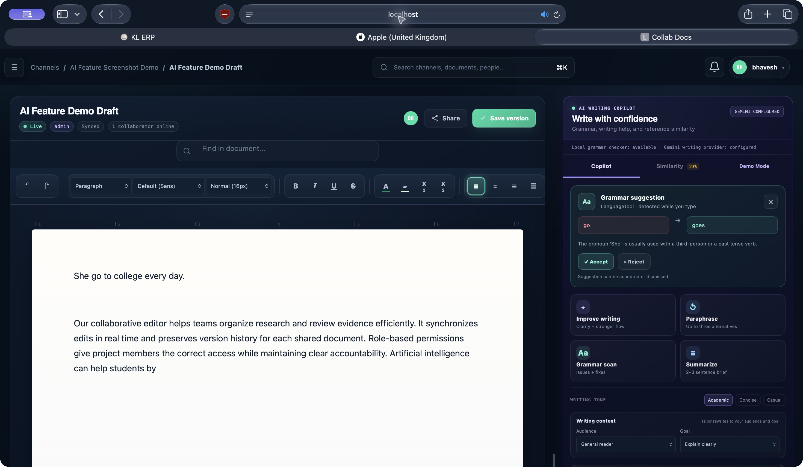
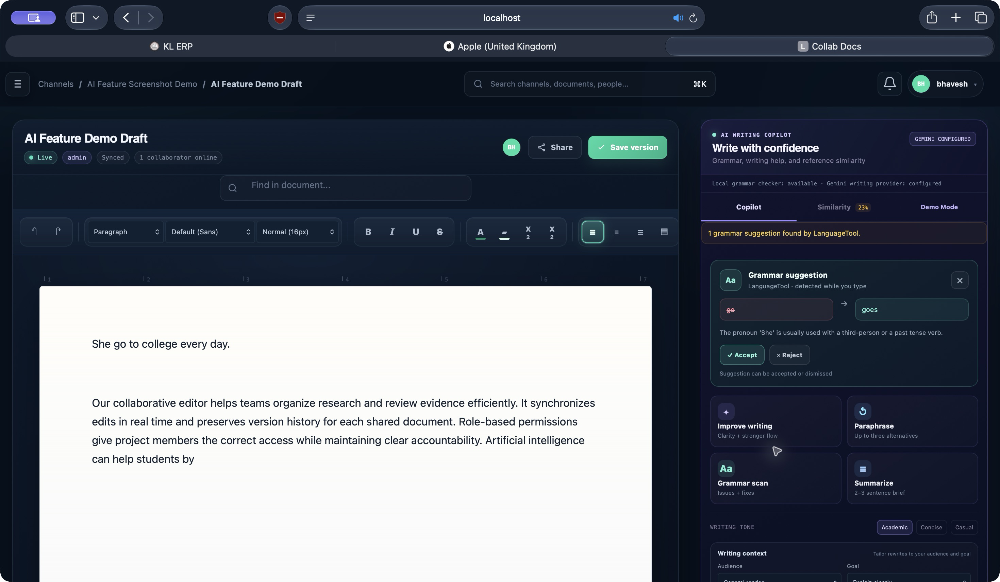
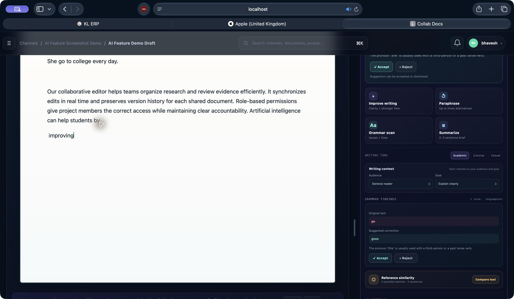
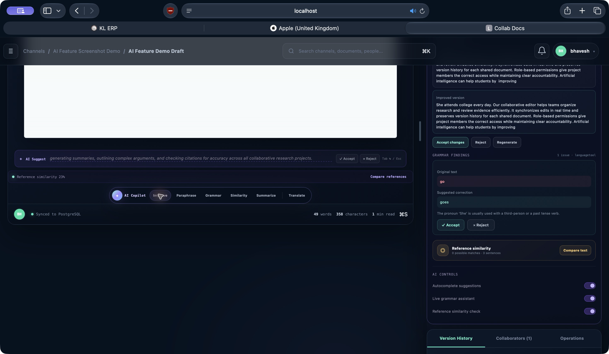
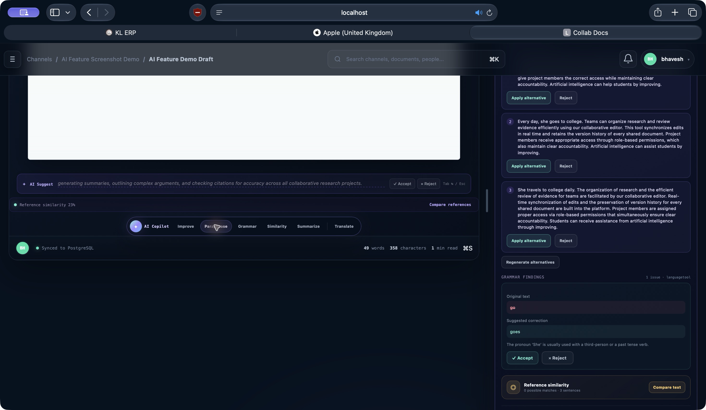
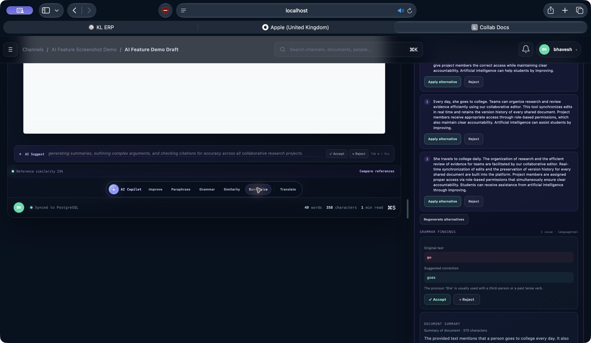
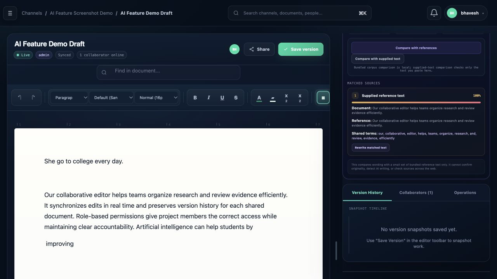
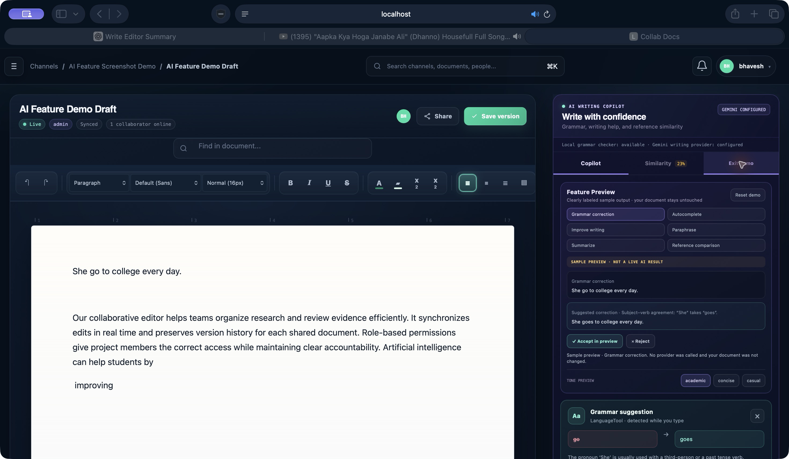
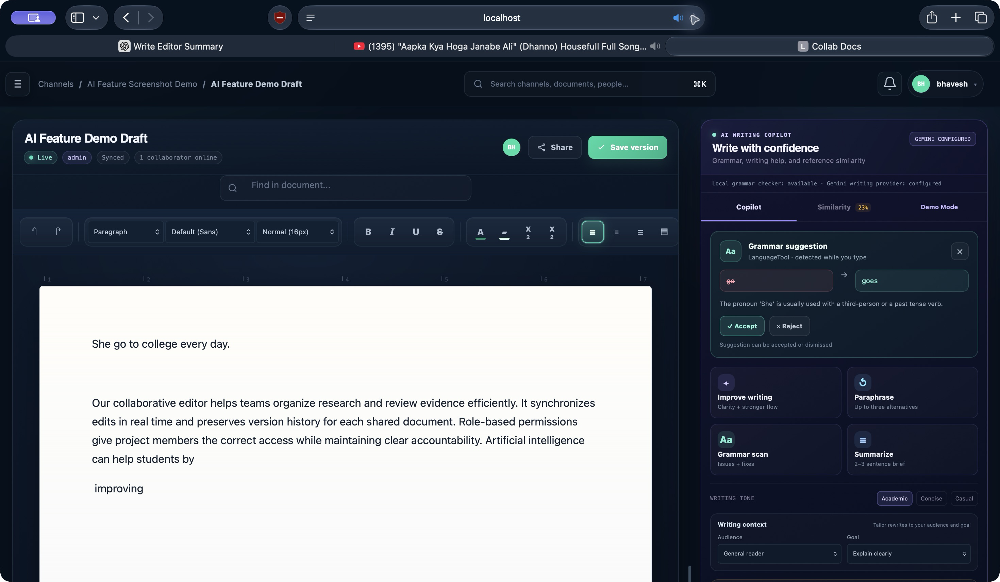

<div align="center">

# 📝 Collab Docs — Real-Time Collaborative Document System

**A DBMS capstone project: real-time collaborative editing with a custom educational CRDT, role-based access, version history, and an AI writing copilot.**


</div>

---

## 🎬 Product walkthrough (4 min)

Watch the full feature walkthrough — every major feature, recorded from the live app:

https://github.com/0xbhavesh404dev/real-time-collaborative-document-system/releases/download/demo-v1/Collab_Docs_Feature_Walkthrough.mp4

> 📥 Prefer downloading? The video is also in the repo at [`demo/Collab_Docs_Feature_Walkthrough.mp4`](demo/Collab_Docs_Feature_Walkthrough.mp4).

---

## 🖼️ The editor at a glance



---

## ❓ The problem it solves

If two people edit a shared document by replacing the whole text, one person's save silently **overwrites** the other's work. Collab Docs represents every edit as an **operation**, merges them with a **CRDT** (so the result is the same on every screen, no matter the arrival order), persists state in **PostgreSQL**, and replicates operations in real time over **Socket.IO** — while keeping authentication, channels, roles, presence, and manual version snapshots.

## ✨ Features

### 🔄 Real-time collaboration
- **Character-based custom CRDT** with unique ids, tombstones, pending operations, deterministic ordering, and idempotency — no ready-made CRDT library
- **Socket.IO document rooms** with initial sync, operation replication, presence, and cursor/typing events
- **Live grammar assistance** while typing (LanguageTool)

### 🗂️ Documents & version history
- Channels with membership and invitations
- **Save, preview, and restore versions** — a restore becomes a *new* version and old versions are kept
- Full formatting toolbar: text styles, fonts, colors, superscript/subscript, lists, tables, images, quotes, code blocks, and more

### 🤖 AI writing copilot
- **Grammar suggestions** with one-click **Accept / Reject**
- **Improve writing**, **Paraphrase** (3 alternatives), **Summarize**, **Translate**
- **Autocomplete** ghost text (off by default; opt-in)
- **Reference similarity check** — compares against a bundled corpus or your own pasted text (local TF-IDF/cosine, not a web-wide plagiarism scan)
- **Demo Mode** — clearly labeled sample results that never touch the real document
- Per-user rate limiting, and AI outputs audited in PostgreSQL

### 🔐 Roles & security
- JWT + bcryptjs authentication
- **Admin / Editor / Viewer** roles enforced on both REST and Socket.IO
- Viewers can read but cannot edit, save, restore, or manage members

## 🖼️ Feature gallery

| | |
|---|---|
|  |  |
| *Grammar scan — issues with explanations and fixes* | *Autocomplete — ghost text before acceptance* |
|  |  |
| *Improve writing — original vs improved, with regenerate* | *Paraphrase — up to three alternatives* |
|  |  |
| *Summarize — 2–3 sentence brief with insert/copy* | *Reference similarity — matching passages & shared terms* |
|  |  |
| *Demo Mode — simulated results, never real edits* | *Accept / Reject a grammar suggestion* |
|  | |
| *Writing context — tone, audience, and goal controls* | |

## 🛠️ Technology stack

| Layer | Tools |
|---|---|
| **Frontend** | React 19, Vite, JavaScript/JSX, React Router, Fetch API, Socket.IO client |
| **Backend** | Node.js, Express, Socket.IO, JWT, bcryptjs |
| **Database** | PostgreSQL + `pg` (users, channels, memberships, documents, CRDT operations, versions, invitations) |
| **AI** | Gemini API (writing tools) + local LanguageTool (grammar) |
| **DevOps** | Docker Compose, GitHub Actions → GHCR images |

## 🚀 Quick start

1. Install **Node.js**, **PostgreSQL**, and **npm**
2. Create and seed the database:

```bash
createdb collab_docs
psql -d collab_docs -f database/schema.sql
```

3. Copy `.env.example` to `.env` and set `DATABASE_URL`, `JWT_SECRET`, and `CLIENT_URL`
   (on a passwordless local macOS PostgreSQL, `DATABASE_URL=postgresql:///collab_docs` works)
4. Start the backend:

```bash
cd server
npm install
npm start
```

5. In another terminal, start the frontend:

```bash
cd client
npm install
npm run dev
```

6. Open **http://localhost:5173**

> Backend health check: `http://localhost:5000/api/health`. If the port is already in use, keep the existing backend and just open the frontend.

## 🐳 Docker deployment

A Docker Compose stack runs the React site, API, and PostgreSQL with the schema loaded automatically:

```bash
# set JWT_SECRET in the root .env first (long random value)
docker compose up --build
# open http://localhost:8080
```

Data lives in the `postgres_data` volume; `docker compose down -v` resets the database.

GitHub Actions (`.github/workflows/docker-publish.yml`) builds and publishes images to **GHCR** on pushes to `main`, `bhavesh-feature`, or `codex/docker-images`, version tags, and manual runs — using the built-in `GITHUB_TOKEN`, no Docker Hub account needed. Images: `<owner>/<repo>-client` and `<owner>/<repo>-server`.

## 🧠 AI & grammar setup

### Gemini (writing tools)

Set `GEMINI_API_KEY` (and optionally `AI_MODEL`) in the server `.env`. Backend routes:

| Route | Purpose |
|---|---|
| `POST /api/ai/autocomplete` | Debounced inline continuation (last 500 chars) |
| `POST /api/ai/paraphrase` | Three rewrite alternatives (academic / casual / concise) |
| `POST /api/ai/grammar` | Grammar, spelling, and clarity suggestions |
| `POST /api/ai/summarize` | Concise 2–3 sentence summary |
| `POST /api/ai/plagiarism` | Local similarity scan vs bundled corpus or supplied text |
| `GET /api/ai/status` | Reports LanguageTool/Gemini availability — never credentials |

Rate limiting: `AI_REQUESTS_PER_MINUTE` (default 60/user). Outputs are audited in `ai_suggestions`; similarity reports in `plagiarism_reports`. Without Gemini, the UI clearly reports the limitation and summaries fall back to a labeled extractive preview.

### LanguageTool (grammar)

```bash
brew install languagetool
brew services start languagetool
```

Set `LANGUAGETOOL_URL` and `LANGUAGETOOL_LANGUAGE` in the server `.env` if needed. Keep the service **local or private** — the free public endpoint doesn't allow automated requests. If LanguageTool is down, the backend makes a single Gemini grammar fallback attempt; repeated checks are cached and stale requests cancelled. Health: `GET /api/ai/grammar/health` (requires sign-in).

## 🏗️ Architecture

React talks to Express over **REST** (accounts, stored resources) while **Socket.IO** carries live operations and awareness events. The server keeps a `TextCRDT` instance per active document and persists JSONB state plus operation history.

📄 Deep dives: [docs/architecture.md](docs/architecture.md) · [docs/database-design.md](docs/database-design.md) · [docs/api.md](docs/api.md) · [docs/crdt-explanation.md](docs/crdt-explanation.md)

### The CRDT in one paragraph

Each character node has `id`, `value`, `leftId`, and `deleted`. Inserts reference their left neighbor, deletes create **tombstones**, and concurrent siblings are sorted by operation id — so delivery order never decides the final text. Operations with missing dependencies wait in `pendingOperations`, and duplicate ids are ignored.

## 🧪 Testing

```bash
cd server
npm run test:crdt     # CRDT convergence tests
```

```bash
cd client
npm run build         # frontend production build
```

**Manual test plan:** register two users → create a channel → join from a second browser → create a document → open in both browsers → edit simultaneously → verify convergence → save two versions → preview the first → restore it → verify the restore creates another version → add a viewer → verify they can read but cannot edit, save, restore, or manage members.

## ⚠️ Limitations & future work

The CRDT is educational rather than production-grade, awareness is basic, and active CRDTs live in one server's memory. The similarity check compares only against the bundled corpus — it is not a web-wide originality or AI-writing detector. Offline multi-server sync, semantic conflict resolution, email, and large-scale deployment are outside the capstone scope. Future work: richer reference sources, comments, attachments, offline support, conflict visualization, and multi-server scaling.

<details>
<summary><strong>🎓 Viva questions (click to expand)</strong></summary>

**What is CRDT?** Conflict-Free Replicated Data Type — replicas modify and merge data so they converge to the same state.

**Why a custom CRDT?** To understand the mechanism instead of hiding it behind a ready-made library.

**Why Socket.IO?** Real-time transport for CRDT operations and awareness events.

**Why PostgreSQL?** Reliable storage for users, channels, memberships, documents, operations, and version history.

**What happens during simultaneous editing?** Each user creates an operation; replicas apply it, and deterministic ordering makes visible states converge.

**What is a tombstone?** A deleted node kept internally so references to its id stay valid.

**What is version control here?** Manual snapshots with author, timestamp, and message — previewable and restorable.

**What happens during restore?** The selected content becomes new CRDT operations and a new version; previous versions stay untouched.

**What is RBAC?** Role-Based Access Control — admin, editor, and viewer roles with different permissions.

</details>

---

<div align="center">

**Built as a DBMS capstone project.** Demo screenshots use a private demo channel — sample data only.

</div>
